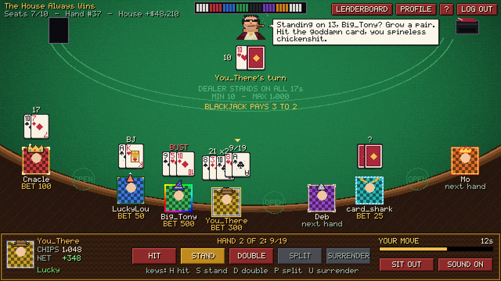
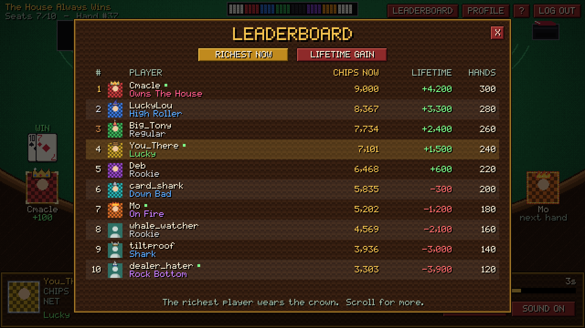
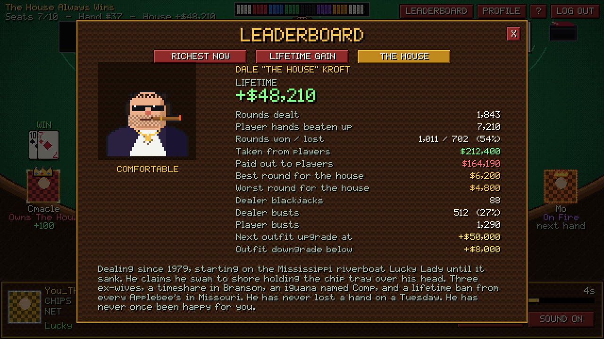

# The House Always Wins

A small multiplayer pixel-art blackjack game. Players connect to an always-on
headless server and play casino blackjack against a scripted dealer. Every
account keeps a lifetime gain/loss that shows up on an in-game leaderboard, an
optional web page and Discord.

- **Server** (`HouseServer.exe`, or a Linux binary) built to run 24/7.
  With nobody connected the table stops and the process just waits. On a
  desktop it opens its own **server window** with every setting, the log, a
  command box and an **Update** button; on a headless box it runs in the
  console as before.
- **Card reveal** (on by default): cards drawn after the deal are shown big in
  the middle of the table and flip after a random 0.5-3 seconds, with a
  suspense sound and a sting for how it went. Dealer cards get stings for how
  the *players* feel about them (cheers for a dealer bust, groans for a 20).
- **Chip gifts:** buy a broke friend back in. Gifts only top someone up to the
  refill amount and don't count as winnings, so nobody can pump an account.
- **Table chat:** short messages pop up in a bubble by your portrait.
- **Chip piles:** everyone's chips sit in a little heap beside their
  portrait that fills out the more they have, with the amount on top.
- **Admins:** make trusted players admins. They get an ADMIN window in the game
  for every server setting and a console, and can type `/commands` in chat as
  if they were at the server, including `/update`.
- **Linux client** (`TheHouseAlwaysWins-linux-amd64` / `-arm64`): the same game
  on Linux desktops, as a single file with nothing to install.
- **Android app** (`TheHouseAlwaysWins.apk`): the same game on your phone,
  held sideways or upright, with touch controls and the on-screen keyboard.
- **Game client** (`TheHouseAlwaysWins.exe`): pixel art that fills the window
  at any size or shape. The layout stretches to fit wide and tall windows,
  switches to a vertical layout when the window is taller than it is wide, and
  scales smoothly while staying sharp. Every image, sound and colour can be replaced (see
  [Replacing the art](#replacing-the-art)).
- **Auto-update:** when you connect to a server running a newer version, the
  game offers to update itself (Windows, Linux and Android).
- **Backups:** the server backs up its data and config automatically and
  survives crashes and damaged files.
- **Accounts** with a username, password and profile picture. Pictures are
  pixelated to 32x32.
- **10+ players** at one table (up to 16). Anyone who connects mid-hand is dealt
  in on the next hand. If the table is full, extra players watch from the rail and
  get the next free seat.
- **Configurable table**: simultaneous or turn-based betting, turn-based or
  all-at-once play, hidden or visible hands, and the usual casino rule options.
- **Daily refill**: once a day, anyone below the refill amount is topped up to it,
  and the top-up is **subtracted from their lifetime gain/loss**.
- **Two leaderboards**: **Richest now** (most chips at this moment) and
  **Lifetime gain** (everything won minus lost, minus refills). They appear in the
  client, on an optional web page and in Discord (a live-updating message,
  `/leaderboard`, `/stats`, `/table`, plus refill, big-win, unlock and new-crown
  announcements).
- **Unlockables**: 26 hats, 11 avatar frames and 26 titles, earned by total
  money bet, chips held at once, lifetime up or down, streaks, blackjacks and
  more. Harder goals have flashier rewards. **Whoever has the most chips right
  now automatically wears The Crown**, the #1 lifetime earner gets the golden
  Laurel Wreath, and whoever has played the most hands wears **The Nightcap**
  (and can use the Marathon Frame and the title Part Of The Furniture). The
  biggest single bet ever made earns **The Chip Tower** and the title Bet The
  Farm, until someone beats it.
- **A dealer with a mouth on him** (optional): he calls out players by name in
  a speech bubble. Busting, standing scared, splitting tens, big losses, losing
  streaks, going broke and lifetime scores all get roasted. A **vulgar mode**
  turns on swearing, crude insults and grumpy old-man rants, and swaps the
  dealer for a fat, cigar-smoking scumbag.
- **The house keeps score too**: a lifetime tracker for the dealer's winnings
  and losses, dealer blackjacks and busts, on its own leaderboard tab.
- Standard library only. Only Go is needed to build, and the client needs no
  cgo or other dependencies.



| Leaderboard | Wardrobe | The House |
|---|---|---|
|  |  |  |

## Quick start

1. Download `TheHouseAlwaysWins.exe` (players) and `HouseServer.exe` (host) from
   the latest **[Release](https://github.com/Cmacle/TheHouseAlwaysWins/releases/latest)**.
2. **Server:** put `HouseServer.exe` in its own folder and run it. The first run
   creates `server.json` and a `data` folder next to it. Edit `server.json` if you
   want to, then restart (or type `reload` in the server window).
3. Forward **TCP port 7777** on your router (or whatever `port` you set) if
   people will connect from outside your network.
4. **Players:** run `TheHouseAlwaysWins.exe`, type the server's IP or domain
   (for example `203.0.113.7` or `blackjack.example.com`) and the port (7777 by
   default) into their own boxes, pick **New account**, choose a username,
   password and picture, and you're seated.

**Using a domain:** point it at your public IP with a DNS **A record**, or a
dynamic DNS name (DuckDNS, No-IP) if your home IP changes. A registrar's "URL
forwarding" or "web redirect" only works for web browsers and won't work for
the game. The domain must resolve straight to your IP, with TCP 7777 forwarded
on your router. Leave `listen_address` as `0.0.0.0`.

The client creates `client.json` and an `assets` folder next to itself on first
run.

**Linux:** download `TheHouseAlwaysWins-linux-amd64` (or `-arm64` for ARM
machines like a Raspberry Pi), make it runnable with
`chmod +x TheHouseAlwaysWins-linux-amd64`, and run it. It's one file with
nothing to install. It runs on X11 desktops, and on Wayland through XWayland
(on by default in GNOME and KDE). Settings go next to the file, or in
`~/.config/thehousealwayswins` if that folder isn't writable. Sound plays
through `pw-play`, `paplay` or `aplay`, the picture picker uses `zenity` or
`kdialog`, and pasting uses `wl-paste`, `xclip` or `xsel`. Most desktops have
these already; without them the game still runs, just without that feature.

**Android:** download `TheHouseAlwaysWins.apk` on your phone and open it. Your
browser or file manager will ask to allow installing apps: say yes for that
app. Updates install over the old version and keep your login. Tap to press
buttons, drag up and down to scroll the leaderboard, and use the phone's back
button to close windows. Turn the phone upright for the vertical layout (two
rows of seats, big buttons at the bottom). When you tap a text box the keyboard
opens and the screen slides up so you can see what you're typing. The
replaceable art lives in
`Android/data/com.cmacle.thehousealwayswins/files/assets` on the phone.

## How a hand works

1. **Betting**: seated players click chips and press **Deal** (or Enter). In
   `simultaneous` mode everyone bets at once and the hand starts as soon as all
   bets are in or the timer runs out. In `turns` mode players bet one at a time.
   Anyone who doesn't bet sits that hand out. After 3 missed hands a player is
   marked as sitting out until they click **Sit in**.
2. **Deal**: two cards each, the dealer's second card face down. If the dealer
   shows an ace or a ten-value card, they peek for blackjack.
3. **Play**: **Hit (H)**, **Stand (S)**, **Double (D)**, **Split (P)**, and
   **Surrender (U)** if enabled. In `turns` mode seats act left to right, each
   with a turn timer. In `simultaneous` mode everyone acts at once against one
   shared timer. Running out of time means you stand.
4. **Dealer** reveals the hole card and draws to 17 (optionally hitting soft 17).
5. **Results**: blackjack pays 3:2 by default, wins pay 1:1, ties push.

## Unlockables

Open **Profile → Wardrobe** (or press W in the profile) to see every hat, frame
and title, how to unlock it, and your progress bar. Click an unlocked item to
wear it. Unlocks are permanent, except the Unique items, which belong to
whoever holds the #1 spot right now.

Goals are tuned to the default $1,000 refill and $10–$1,000 bets: Common items
come in your first session, while Legendary ones take a long grind or a heater.
Rare and better unlocks are announced at the table. Epic and better ones, plus
every new crown holder, are announced on Discord.

The crown goes to the player with the **most chips** as of the last settled
hand. They need strictly more than the refill amount and no tie for first.
Taking the crown is announced to everyone.

**Hats**

| Name | Tier | How to unlock |
|---|---|---|
| Party Hat | Common | Bet a total of $1,000 |
| Ball Cap | Common | Play 25 hands |
| Beanie | Common | Bet a total of $5,000 |
| Propeller Beanie | Uncommon | Play 250 hands |
| Cowboy Hat | Uncommon | Bet a total of $25,000 |
| Tin Foil Hat | Uncommon | Be down $3,000 lifetime |
| Sombrero | Uncommon | Have $2,000 at once |
| Traffic Cone | Uncommon | Bust 50 times |
| Top Hat | Rare | Bet a total of $100,000 |
| Fez | Rare | Get 25 blackjacks |
| Pirate Hat | Rare | Have $5,000 at once |
| Dunce Cap | Rare | Be down $10,000 lifetime |
| Viking Helmet | Rare | Win 6 hands in a row |
| Halo | Epic | Be up $5,000 lifetime |
| Devil Horns | Epic | Lose 10 hands in a row |
| Wizard Hat | Epic | Bet a total of $500,000 |
| Unicorn Horn | Epic | Win $2,000 in one round |
| Graduation Cap | Epic | Play 2,000 hands |
| Golden Top Hat | Legendary | Be up $25,000 lifetime |
| Diamond Tiara | Legendary | Have $25,000 at once |
| Hair On Fire | Legendary | Win 10 hands in a row |
| Space Helmet | Legendary | Bet a total of $2,500,000 |
| The Crown | Unique | Be #1 on the Richest leaderboard |
| Laurel Wreath | Unique | Be #1 on the Lifetime leaderboard |
| The Nightcap | Unique | Play more hands than anyone (all games) |
| The Chip Tower | Unique | Make the biggest single bet (all games); kept until beaten |

**Frames**

| Name | Tier | How to unlock |
|---|---|---|
| Plain Frame | Common | Free for everyone |
| Felt Frame | Common | Bet a total of $2,500 |
| Silver Frame | Uncommon | Play 100 hands |
| Gold Frame | Rare | Have $3,000 at once |
| Ruby Frame | Rare | Get 10 blackjacks |
| Frozen Frame | Rare | Lose 7 hands in a row |
| Bone Frame | Epic | Be down $25,000 lifetime |
| Inferno Frame | Epic | Win 8 hands in a row |
| Diamond Frame | Legendary | Have $10,000 at once |
| Rainbow Frame | Legendary | Bet a total of $1,000,000 |
| Marathon Frame | Unique | Play more hands than anyone (all games) |

**Titles**

| Name | Tier | How to unlock |
|---|---|---|
| Rookie | Common | Free for everyone |
| Regular | Common | Play 50 hands |
| Lucky | Uncommon | Win 5 hands in a row |
| Cursed | Uncommon | Lose 7 hands in a row |
| Big Fish | Uncommon | Have $2,000 at once |
| In The Red | Uncommon | Be down $2,000 lifetime |
| Bust Master | Uncommon | Bust 100 times |
| Splitter | Uncommon | Split 25 times |
| Refill Regular | Uncommon | Receive 10 daily refills |
| Shark | Rare | Be up $2,500 lifetime |
| High Roller | Rare | Bet a total of $100,000 |
| Down Bad | Rare | Be down $10,000 lifetime |
| Double Trouble | Rare | Win 25 doubled hands |
| Professional Degenerate | Rare | Receive 30 daily refills |
| Card Shark | Epic | Get 50 blackjacks |
| On Fire | Epic | Win 9 hands in a row |
| Comeback Kid | Epic | Fall $5,000 behind, then get back to even |
| Rock Bottom | Epic | Be down $50,000 lifetime |
| Iron Butt | Epic | Play 5,000 hands |
| Whale | Legendary | Bet a total of $1,000,000 |
| Tycoon | Legendary | Have $50,000 at once |
| Living Legend | Legendary | Be up $50,000 lifetime |
| Owns The House | Unique | Be #1 on the Richest leaderboard |
| The G.O.A.T. | Unique | Be #1 on the Lifetime leaderboard |
| Part Of The Furniture | Unique | Play more hands than anyone (all games) |
| Bet The Farm | Unique | Make the biggest single bet (all games); kept until beaten |

## The dealer

With `dealer_trash_talk` on, the dealer reacts to what happens at the table
and calls players out by name in a speech bubble:

- **Betting:** he dares players who bet small to go big (naming a number),
  nags whoever is running out the betting clock, and comments on min, max,
  all-in and big-chunk bets, raising after a loss (chasing), shrinking a bet,
  doubling up, betting first and betting last.
- **Decisions:** busting (extra abuse for hitting a hard 17+), standing scared
  on 12–16 against a strong up card, standing on 11 or less, splitting tens
  (or anything else), surrendering, doubling, hitting to 21, five-card hands,
  and a slow player's turn clock.
- **Results:** big losses (with the amount), winning and losing streaks,
  pushes, doubles won and lost, going broke, blackjacks, sweeps, his own
  busts, and drawing out to 21 on everybody.
- **The table:** his up card (an ace, or a weak 4-6), people leaving, the daily
  refill landing, and being alone with one player.
- **Between hands:** roasts based on lifetime scores (worst on the board, the
  crown holder, deep in the red, suspiciously up), bragging about the house,
  fake breaking news about players, rating someone's play, "Dale's Tip of the
  Hand" (terrible advice), phone calls from people in his past, talking to his
  iguana, made-up house rules, daily affirmations and bits of his old lounge
  songs.

He keeps it to about three small remarks a hand at the normal pace (five in
turbo), with a short breather between them. Big moments (busts, blackjacks,
someone going broke) always get a reaction.

He also makes up humiliating stories about players ("{name} is the kind of guy
who falls in the toilet at least once a week"), tells stories from his past,
shares hot takes on random topics, and says ominous, cryptic things.

He has a name and a past: **Dale "The House" Kroft**, born in 1951 on a card
table in Cape Girardeau, Missouri, and dealing since 1979, when he took his
late father's seat on a riverboat that later sank. Three ex-wives, a son who
won't call, a timeshare in Branson, an iguana named Comp, and a cut of
everything the house takes. His bio is on the leaderboard's **THE HOUSE** tab,
and his whole life story is in [docs/DALE.md](docs/DALE.md). Every line he
says fits it.

**He tells long stories.** Every so often, between hands, he launches into one
of 27 multi-paragraph stories about his life: the night the Lucky Lady sank,
his father's last shuffle, the six minutes he was dead, the Applebee's riblets
incident, how he won Comp in a Shreveport tire shop. They're told a bubble at
a time. Small talk waits until he's done; if something big happens mid-story
(a bust, a blackjack), he stops to rub it in and then picks the story back up
where he left off. Stories are rare: at most one every 15 minutes at the normal pace (25 in
turbo), and only sometimes even then.

**The dealer log.** The little speech bubble next to the dealer (or **T**)
opens everything he's said lately, stories included, so you can catch up on
what you missed. A red dot means there's something new. Players who join get
the recent history too.

**He dresses by how the house is doing.** His outfit follows the house's
lifetime net in big steps, so it doesn't flip back and forth:

| House lifetime | Look |
|---|---|
| -$50,000 or worse | Destitute: rags, beard, cardboard sign |
| -$20,000 | Broke: stained tank top, cigarette butt |
| -$5,000 | Struggling: crooked tie, torn visor |
| between | Working stiff |
| +$10,000 | Comfortable: velvet jacket, gold chain |
| +$50,000 | Rich: white tux, two chains |
| +$150,000 | Loaded: fur coat, gold tooth, diamond rings |
| +$500,000 | Tycoon: top hat, diamond monocle |
| +$1,500,000 | Emperor: gold crown, royal cape, scepter |

Moving away from even happens as soon as a line is crossed. Moving back needs
a buffer of 10% (at least $2,000), so a single hand can't flip him back and
forth. He thanks whoever paid for each upgrade, very rudely. When he loses an
outfit he's incredibly petty with whoever won it off him. When he's down, he
begs for sympathy, badly. The house tab shows where his next upgrade and
downgrade kick in. Players' titles show under their names at the table.

He talks like an old 8-bit RPG character: words pop into the bubble one at a
time, his mouth flaps, and each word makes a little blip. The vulgar dealer's
voice is a low, gravelly grumble. Lines stay up long enough to read, longer
for long ones, and anything too long for the bubble is split into pages.

There are over 2,000 lines across both modes. They're dealt like a shuffled
deck per situation, and recently used lines are skipped, so repeats are rare.
`dealer_vulgar` adds the uncensored set and swaps in the cigar-smoking dealer
sprite row in `dealers.png`. Lines live in `internal/banter/lines.go` if you
want to write your own.

**The house's lifetime stats** (net, total taken, total paid out, rounds
won/lost, best and worst round, dealer blackjacks and busts, player busts) are
saved in `data/house.json`. They show on the leaderboard's **THE HOUSE** tab,
in the top bar, on the web page, in Discord, and via the `house` console
command.

## Server configuration (`server.json`)

| Key | Default | Meaning |
|---|---|---|
| `server_name` | The House Always Wins | Shown in the client, web page and Discord |
| `motd` | … | Message shown to players when they join |
| `listen_address` / `port` | `0.0.0.0` / `7777` | Where players connect (TCP) |
| `data_dir` | `data` | Accounts, avatars, log. Relative to the config file |
| `max_players` | 10 | Seats at the table (1–16) |
| `max_spectators` | 20 | People allowed to wait on the rail when seats are full |
| `allow_registration` | true | Let new players create accounts |
| `offer_client_updates` | true | Offer players with an older game the update when they connect |
| `backup_interval_minutes` | 60 | How often to back up while things are changing (0 = only at start and stop) |
| `backup_keep` / `backup_days` | 48 / 30 | Keep the newest 48 backups, plus one a day for 30 days |
| `server_password` | "" | If set, new players must enter it to create an account (existing accounts log in normally) |
| `refill_amount` | 1000 | Starting chips, and the daily top-up level |
| `refill_time` | `00:00` | When the daily refill happens (24h) |
| `timezone` | `Local` | Time zone for `refill_time`, e.g. `America/Chicago` |
| `min_bet` / `max_bet` | 10 / 1000 | Table limits |
| `betting_mode` | `simultaneous` | `simultaneous` or `turns` |
| `play_mode` | `turns` | `turns` (one hand at a time) or `simultaneous` (all at once) |
| `hide_other_hands` | false | Hide other players' cards until the results |
| `decks` | 6 | Decks in the shoe (1–8) |
| `penetration` | 0.75 | How much of the shoe is dealt before reshuffling |
| `dealer_hits_soft_17` | false | H17 instead of S17 |
| `blackjack_pays` | `3:2` | e.g. `6:5` |
| `double_after_split` | true | |
| `double_on` | `any` | `any`, `9-11` or `10-11` |
| `max_split_hands` | 4 | |
| `resplit_aces` / `hit_split_aces` | false / false | |
| `allow_surrender` | false | Late surrender |
| `card_reveal` | true | Cards drawn after the deal are revealed slowly, big in the middle of the table |
| `card_reveal_min_seconds` / `card_reveal_max_seconds` | 0.5 / 3 | The random wait before a revealed card flips |
| `table_chat` | true | Players can chat (admins always can, for commands) |
| `chip_gifts` | true | Players can send chips to someone with less than `refill_amount` |
| `gift_refills_per_day` | 1 | Most one player can be sent per refill period, in refill amounts (0 = no daily cap) |
| `turbo_mode` | false | The old fast pace: 15s bets, 20s turns, quick dealing, a chattier dealer. Ignores the six timing settings below |
| `betting_time_seconds` | 20 | Betting timer (per player in `turns` betting) |
| `turn_time_seconds` | 25 | Per-turn timer in `turns` play mode |
| `play_time_seconds` | 40 | Shared timer in `simultaneous` play mode |
| `results_time_seconds` | 8 | How long results stay up |
| `deal_delay_ms` / `dealer_delay_ms` | 700 / 1100 | Pacing of the deal and the dealer's draws (the deal delay is also the pause between players' turns) |
| `dealer_trash_talk` | true | The dealer roasts players in a speech bubble |
| `dealer_vulgar` | false | Uncensored dealer: swearing, crude insults, cigar-smoking scumbag sprite |
| `http_leaderboard` | disabled, port 8090 | Optional web page with both leaderboards (`/`, `/leaderboard.json?sort=balance\|net`) |
| `discord` | disabled | See below |

When you update the server, any settings added in the new version are written
into your existing `server.json` with their default values the next time it
starts (your values are kept), and the log says which ones were added.
Coming from a version before `turbo_mode`, any timing you never changed moves
to the new slower default; timings you set yourself are kept. Set
`turbo_mode` to true to get the old pace back.

Table changes from `reload` take effect at the start of the next hand. Changing
the port or turning on the web page or Discord needs a restart.

### Daily refill

At `refill_time` each day, every account with fewer than `refill_amount` chips is
set to `refill_amount`, and the chips added are subtracted from its lifetime
gain/loss. That way a player can't climb the leaderboard just by going broke
every day. Players in the middle of a hand are topped up when the hand ends.
Accounts that were offline are processed at the boundary too. If the server was
down at refill time, the refill runs when it starts back up.

## Discord

Set `"enabled": true` in the `discord` section and pick **one** of these:

**Bot (recommended: live leaderboard, slash commands, announcements)**

1. Go to <https://discord.com/developers/applications>, click **New Application**,
   open the **Bot** tab and **Reset Token**. Put the token in `bot_token`.
2. Under **OAuth2 → URL Generator**, tick the scopes `bot` and
   `applications.commands` and the permissions **Send Messages**,
   **Embed Links** and **View Channel**. Open the URL and add the bot to your
   server.
3. In Discord, turn on Developer Mode (Settings → Advanced), right-click the
   channel for the leaderboard and choose **Copy Channel ID**. Put it in
   `leaderboard_channel_id`. Optionally set `announce_channel_id` for
   announcements, and `guild_id` (your server's ID) so slash commands show up
   immediately.

The bot posts one leaderboard message and keeps editing it (after changes, and
at least every `update_interval_minutes`) showing both leaderboards. It answers
`/leaderboard [board] [count]` (board: both, richest or lifetime),
`/stats <player>` and `/table`.

**Webhook (simplest: live leaderboard + announcements, no slash commands)**

Channel settings → Integrations → Webhooks → New Webhook → Copy URL. Put the URL
in `webhook_url` and leave `bot_token` empty.

Other options: `leaderboard_size` (max 25), `announce_refills`,
`big_win_threshold` (announce single-hand wins at least this big; 0 turns it off).

## Running the server 24/7

The server uses almost no CPU when the table is empty.

- **Windows, simplest:** run `run-server.bat`. It restarts the server if it ever
  exits.
- **Windows, at boot:** in Task Scheduler, create a task that runs
  `HouseServer.exe -noconsole` "At startup", whether the user is logged on or not,
  with "Start in" set to the server folder. Or use [NSSM](https://nssm.cc/) to
  install it as a service.
- **Linux:** see `deploy/thehousealwayswins.service` for a systemd unit.

### The server window

On Windows (and on Linux with a desktop) the server opens a window:

- **SETTINGS:** every `server.json` setting. Switches toggle with a click;
  type a value and press SAVE (or Enter). Values are checked first, written to
  `server.json` and reloaded straight away. Table settings apply from the next
  hand; the port needs a restart.
- **LOG + COMMANDS:** the live server log and a command box for any console
  command (Up/Down recalls earlier ones).
- **UPDATE:** checks GitHub for a newer server. When there is one the button
  turns gold; click it and the server downloads it, checks it against
  `SHA256SUMS.txt`, backs up, swaps itself out and restarts, window and all.

Closing the window saves and stops the server. Use `-nogui` (or `-noconsole`,
as services do) to run without it.

### Admins

Type `admin <name>` in the server window (or console) to make someone an
admin, `admin <name> off` to undo it, `admins` to list them. Admins get:

- An **ADMIN** button in the game: the same settings editor and console as the
  server window.
- **/commands in chat:** anything you can type at the server, e.g.
  `/players`, `/give Lou 500`, `/set card_reveal off`, `/kick someone`.
  The output pops up on screen.
- **`/update`:** updates the server from GitHub and restarts it. Reconnect a
  few seconds later and your game offers you the matching update.

### Updating the server

`update` (in the window, console, or `/update` as an admin) installs the newest
GitHub release for this platform and restarts. `update force` reinstalls the
current one; `version` shows this version and the latest. The server also
checks every few hours and logs when a new version is out. Under
`run-server.bat` or the systemd unit it just exits after installing and lets
them start the new version; otherwise it starts the new version itself.

### Updates for players

When a player connects, the server tells them its version. If their game is
older, they're offered the update: **UPDATE NOW** downloads it, checks it and
installs it.

- **Windows and Linux:** the game replaces itself and restarts, and the saved
  login carries over. The folder the game is in has to be writable.
- **Android:** the system installer opens. The first time, Android asks you to
  allow the app to install updates. Turn that on and come back.

Updates always come from this project's GitHub releases, never from the server
itself, so a server can't push anything else to players. Every download is
checked against the release's `SHA256SUMS.txt` and thrown away if it doesn't
match. To update everyone, update the server: players are offered the matching
version the next time they connect. Set `offer_client_updates` to `false` to
turn the offers off.

### Backups and crash safety

- **Saves:** data is saved every 5 seconds. Each save is written to a temporary
  file, flushed to disk and then swapped in, so a crash or power cut can't
  leave a half-written file. The previous save is kept as `accounts.json.bak`.
- **Backups:** zip files in `data/backups` hold the accounts, house stats,
  avatars and `server.json`. One is made when the server starts, every
  `backup_interval_minutes` (60) if anything changed, before `delete` and
  `resetstats`, and at shutdown. The newest `backup_keep` (48) are kept, plus
  one per day for `backup_days` (30) days.
- **Damaged files:** if `accounts.json` or `house.json` won't load, the server
  sets the bad file aside (`.corrupt-<time>`), loads the previous save or the
  newest good backup, and says so in the log.
- **Config typos:** if `server.json` won't load, it runs with the last config
  that worked (`server.json.lastgood`) and tells you what's wrong.
- **Crashes:** if something goes wrong mid-hand, the crash is caught and
  logged, the hand is called off with every bet returned, and the table keeps
  going. The server doesn't go down.
- **Restoring:** type `backups` to list them and `restore <name>` to put one
  back. The current data is backed up first, then restart the server.

### Server console commands

Type these into the server window:

```
players | leaderboard [n] [rich] | stats <user> | accounts | house
give <user> <amount>        add/remove chips without touching lifetime net
refill <user|all>           immediate top-up (counts against net)
resetstats <user> | setpassword <user> <pass> | delete <user> | kick <user>
say <message> | reload | save | quit
backup | backups | restore <backup>
admin <user> [on|off] | admins
get [filter] | set <setting> <value>
update [force] | version
```

### Chip gifts

Click a player at the table (or GIFT on the leaderboard) to send them chips.
You can only help someone with less than `refill_amount`, and only up to it:
chips they have on the table count. Each player can be sent at most
`gift_refills_per_day` refills' worth per day. Gifted chips are subtracted from
the receiver's lifetime gain (like a refill) and added back to the sender's, so
the Lifetime board only ever shows what was won from the house.

## Client

| Key | Action |
|---|---|
| Click chips / right-click | Add / remove from your bet (mouse wheel also adjusts) |
| Enter | Deal (place bet) |
| R / C | Rebet last amount / clear |
| T | Dealer log: everything he's said lately |
| Y or SAY | Chat (Enter sends, Esc cancels). Admins: `/` starts a command |
| Click a player | Send them chips (when they're below the refill amount) |
| H S D P U | Hit, Stand, Double, Split, Surrender |
| L | Leaderboard (left/right switches Richest / Lifetime / The House) |
| W (in Profile) | Wardrobe: hats, frames, titles |
| O or SETTINGS | Volume: master, sound effects, dealer voice, card reveal (0 = muted) |
| M | Mute / unmute everything |
| F1 or ? | How to play |
| F11 or Alt+Enter | Fullscreen |
| Esc | Close a window |

`client.json` stores the server address, your remembered login (a revocable
token, never your password), the volume settings (`volume`, `effects_volume`,
`voice_volume`, `reveal_volume`, 0-100), `window_scale` (0 = automatic) and `fullscreen`. Logging out forgets the saved login.

### Replacing the art

On first run the client writes every default asset into `assets/` with a
`README.txt` describing each file. Replace any file with your own using the same
name and layout, then restart the client. Delete a file to get the default back.

- Images are PNGs drawn at 1x for a 640x360 screen: table, card sheet (13x4),
  card back, chips, dealer, shoe, logo, default avatar, icon, buttons, panels,
  fields, checkbox, turn arrow, **hats.png** (the 24 hats) and **frames.png**
  (the 10 avatar frames).
- The default table is redrawn to fit any window shape. If you replace
  `table.png` with your own, it's stretched to fill the window instead, so
  keep it simple (felt and rail) if you play in odd shapes.
- `font.png` is a 16x6 grid of ASCII glyphs. Character widths are measured
  automatically.
- Sounds are WAV files: card, chip, click, win, blackjack, lose, push, bust,
  turn, refill, shuffle, error, plus the dealer's voice blips (talk1-4, and
  talklow1-4 for the vulgar dealer).
- `theme.json` holds card/chip sizes, chip values, the 9-slice border and every
  text colour.

## Building from source

Requires Go 1.24+.

```sh
go test ./...                          # rules, accounts, refill, bot simulations, websocket, client e2e
go run ./tools/genassets               # regenerate the default pixel art + sounds
GOOS=windows GOARCH=amd64 go build -ldflags "-H windowsgui" -o TheHouseAlwaysWins.exe ./cmd/client
GOOS=windows GOARCH=amd64 go build -o HouseServer.exe ./cmd/server
go build -o house-server ./cmd/server  # Linux/macOS server
CGO_ENABLED=0 go build -o TheHouseAlwaysWins ./cmd/client  # Linux client (static)
```

On Windows you can just run `scripts\build.bat`.

### Windows antivirus warnings

The Windows builds include an icon, version info (publisher, description,
version) and an app manifest, generated by `tools/winres` and linked in as a
`.syso` file, and they're built with their symbols kept. `scripts/build.sh`
and `scripts/build.bat` do this for you. A bare `go build` works too but
produces an anonymous exe, which Windows Defender is more likely to flag by
mistake. If a build is still flagged, report it as a false positive at
https://www.microsoft.com/wdsi/filesubmission. Signing the exes with a
code-signing certificate stops it for good.

### Android build

The APK is built by GitHub Actions: `gomobile bind` compiles `./mobile` (the
Go bridge) into `android/app/libs/housecore.aar`, then Gradle builds the small
Java app in `android/`. To build it yourself you need the Android SDK and NDK,
Java 17 and Gradle 8.11:

```sh
go install golang.org/x/mobile/cmd/gomobile@latest && gomobile init
go get golang.org/x/mobile/bind
gomobile bind -target=android/arm64,android/arm -androidapi 21 -o android/app/libs/housecore.aar ./mobile
cd android && gradle assembleRelease
```

The APK is signed with `android/app/release.keystore` (password
`thehousealwayswins`), which is committed so every build can update the
installed app. It only identifies this app; it isn't a secret worth guarding
for a friends-only game.

### Automatic releases

Every push to `main` makes GitHub Actions run the tests, build everything and
publish it to the GitHub Release named after the `VERSION` file (for example
`v1.0.0`): the two exes, the Linux server binaries and the zips.

- Change `VERSION` (say to `1.1.0`) and push to cut a **new** release.
- Any other push to `main` rebuilds and **replaces the files** on the current
  release, so the download links always have the latest build.
- Pushing a tag like `v1.2.3` also creates a release for that tag.

To render every client screen to PNG without Windows (useful when changing art):
`PREVIEW_DIR=out go test -run TestPreview ./internal/client/`

### Layout

```
cmd/server        server entry point
cmd/client        client entry point (Windows)
internal/blackjack  cards, shoe, rules, settlement
internal/proto      JSON-lines wire protocol
internal/cosmetics  catalogue of hats, frames and titles + unlock rules
internal/banter     the dealer's trash talk lines and no-repeat picker
internal/server     game loop, accounts, refill, console, web leaderboard
internal/discord    Discord REST + gateway (built-in websocket client)
internal/client     renderer, UI, screens (platform independent)
internal/win32      Windows window/input/sound layer (no cgo)
internal/x11        the Linux window: an X11 client written in Go (no C libraries)
internal/selfupdate swapping the desktop client for a new version
mobile              bridge for the Android app (gomobile bind)
android             the Android app (Java): drawing, touch, keyboard, sound
tools/genassets     generates the default pixel art and sounds
```

## Notes

- The game runs on Windows, Linux and Android. Only the platform layers
  (`internal/win32`, `mobile` + `android`) are OS-specific.
- Insurance and even money aren't offered. The dealer peeks with an ace or a
  ten showing, so you never lose a double or split to a dealer blackjack.
- Chips are play money with no cash value.

## License

Copyright (c) 2026 Cmacle. All rights reserved.

This is **not** open source. The code is public so it can be read, not
reused. You may download the [official releases](https://github.com/Cmacle/TheHouseAlwaysWins/releases)
and play them, and host a server for yourself and your friends, for personal,
non-commercial use. You may not copy, modify, redistribute or reuse the code,
art, sounds, characters or text, use it commercially, or use it to train AI
models, without written permission. See [LICENSE](LICENSE) for the full terms
and [THIRD_PARTY_NOTICES.md](THIRD_PARTY_NOTICES.md) for the Go components the
programs include.
