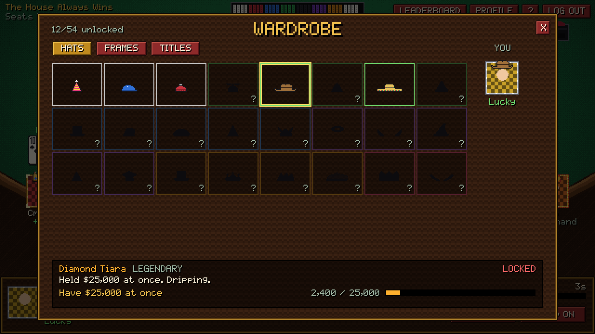

# The House Always Wins

A small multiplayer pixel-art blackjack game. Players connect to an always-on
headless server and play casino blackjack against a scripted dealer. Every
account keeps a lifetime gain/loss that shows up on an in-game leaderboard, an
optional web page and Discord.

- **Headless server** (`HouseServer.exe`, or a Linux binary) built to run 24/7.
  With nobody connected the table stops and the process just waits.
- **Game client** (`TheHouseAlwaysWins.exe`): pixel art at 640x360, scaled up by
  whole pixels. Every image, sound and colour can be replaced (see
  [Replacing the art](#replacing-the-art)).
- **Accounts** with a username, password and profile picture. Pictures are
  pixelated to 32x32.
- **10+ players** at one table (up to 16). Anyone who connects mid-hand is dealt
  in on the next hand. If the table is full, extra players watch from the rail and
  get the next free seat.
- **Configurable table**: simultaneous or turn-based betting, turn-based or
  all-at-once play, hidden or visible hands, and the usual casino rule options.
- **Daily refill**: once a day, anyone below the refill amount is topped up to it,
  and the top-up is **subtracted from their lifetime gain/loss**.
- **Two leaderboards**: **Richest now** (most chips at this moment) and
  **Lifetime gain** (everything won minus lost, minus refills). They appear in the
  client, on an optional web page and in Discord (a live-updating message,
  `/leaderboard`, `/stats`, `/table`, plus refill, big-win, unlock and new-crown
  announcements).
- **Unlockables**: 24 hats, 10 avatar frames and 24 titles, earned by total
  money bet, chips held at once, lifetime up or down, streaks, blackjacks and
  more. Harder goals have flashier rewards. **Whoever has the most chips right
  now automatically wears The Crown**, and the #1 lifetime earner gets the golden
  Laurel Wreath.
- Standard library only. Only Go is needed to build, and the client needs no
  cgo or other dependencies.


| Leaderboard | Wardrobe |
|---|---|
|  |  |

## Quick start

1. Download `TheHouseAlwaysWins.exe` (players) and `HouseServer.exe` (host) from
   the latest **[Release](https://github.com/Cmacle/TheHouseAlwaysWins/releases/latest)**.
2. **Server:** put `HouseServer.exe` in its own folder and run it. The first run
   creates `server.json` and a `data` folder next to it. Edit `server.json` if you
   want to, then restart (or type `reload` in the server window).
3. Forward **TCP port 7777** on your router (or whatever `port` you set) if
   people will connect from outside your network.
4. **Players:** run `TheHouseAlwaysWins.exe`, type the server's IP or domain
   (for example `203.0.113.7` or `blackjack.example.com`) and the port (7777 by
   default) into their own boxes, pick **New account**, choose a username,
   password and picture, and you're seated.

**Using a domain:** point it at your public IP with a DNS **A record**, or a
dynamic DNS name (DuckDNS, No-IP) if your home IP changes. A registrar's "URL
forwarding" or "web redirect" only works for web browsers and won't work for
the game. The domain must resolve straight to your IP, with TCP 7777 forwarded
on your router. Leave `listen_address` as `0.0.0.0`.

The client creates `client.json` and an `assets` folder next to itself on first
run.

## How a hand works

1. **Betting**: seated players click chips and press **Deal** (or Enter). In
   `simultaneous` mode everyone bets at once and the hand starts as soon as all
   bets are in or the timer runs out. In `turns` mode players bet one at a time.
   Anyone who doesn't bet sits that hand out. After 3 missed hands a player is
   marked as sitting out until they click **Sit in**.
2. **Deal**: two cards each, the dealer's second card face down. If the dealer
   shows an ace or a ten-value card, they peek for blackjack.
3. **Play**: **Hit (H)**, **Stand (S)**, **Double (D)**, **Split (P)**, and
   **Surrender (U)** if enabled. In `turns` mode seats act left to right, each
   with a turn timer. In `simultaneous` mode everyone acts at once against one
   shared timer. Running out of time means you stand.
4. **Dealer** reveals the hole card and draws to 17 (optionally hitting soft 17).
5. **Results**: blackjack pays 3:2 by default, wins pay 1:1, ties push.

## Unlockables

Open **Profile → Wardrobe** (or press W in the profile) to see every hat, frame
and title, how to unlock it, and your progress bar. Click an unlocked item to
wear it. Unlocks are permanent, except the Unique items, which belong to
whoever holds the #1 spot right now.

Goals are tuned to the default $1,000 refill and $10–$1,000 bets: Common items
come in your first session, while Legendary ones take a long grind or a heater.
Rare and better unlocks are announced at the table. Epic and better ones, plus
every new crown holder, are announced on Discord.

The crown goes to the player with the **most chips** as of the last settled
hand. They need strictly more than the refill amount and no tie for first.
Taking the crown is announced to everyone.

**Hats**

| Name | Tier | How to unlock |
|---|---|---|
| Party Hat | Common | Bet a total of $1,000 |
| Ball Cap | Common | Play 25 hands |
| Beanie | Common | Bet a total of $5,000 |
| Propeller Beanie | Uncommon | Play 250 hands |
| Cowboy Hat | Uncommon | Bet a total of $25,000 |
| Tin Foil Hat | Uncommon | Be down $3,000 lifetime |
| Sombrero | Uncommon | Have $2,000 at once |
| Traffic Cone | Uncommon | Bust 50 times |
| Top Hat | Rare | Bet a total of $100,000 |
| Fez | Rare | Get 25 blackjacks |
| Pirate Hat | Rare | Have $5,000 at once |
| Dunce Cap | Rare | Be down $10,000 lifetime |
| Viking Helmet | Rare | Win 6 hands in a row |
| Halo | Epic | Be up $5,000 lifetime |
| Devil Horns | Epic | Lose 10 hands in a row |
| Wizard Hat | Epic | Bet a total of $500,000 |
| Unicorn Horn | Epic | Win $2,000 in one round |
| Graduation Cap | Epic | Play 2,000 hands |
| Golden Top Hat | Legendary | Be up $25,000 lifetime |
| Diamond Tiara | Legendary | Have $25,000 at once |
| Hair On Fire | Legendary | Win 10 hands in a row |
| Space Helmet | Legendary | Bet a total of $2,500,000 |
| The Crown | Unique | Be #1 on the Richest leaderboard |
| Laurel Wreath | Unique | Be #1 on the Lifetime leaderboard |

**Frames**

| Name | Tier | How to unlock |
|---|---|---|
| Plain Frame | Common | Free for everyone |
| Felt Frame | Common | Bet a total of $2,500 |
| Silver Frame | Uncommon | Play 100 hands |
| Gold Frame | Rare | Have $3,000 at once |
| Ruby Frame | Rare | Get 10 blackjacks |
| Frozen Frame | Rare | Lose 7 hands in a row |
| Bone Frame | Epic | Be down $25,000 lifetime |
| Inferno Frame | Epic | Win 8 hands in a row |
| Diamond Frame | Legendary | Have $10,000 at once |
| Rainbow Frame | Legendary | Bet a total of $1,000,000 |

**Titles**

| Name | Tier | How to unlock |
|---|---|---|
| Rookie | Common | Free for everyone |
| Regular | Common | Play 50 hands |
| Lucky | Uncommon | Win 5 hands in a row |
| Cursed | Uncommon | Lose 7 hands in a row |
| Big Fish | Uncommon | Have $2,000 at once |
| In The Red | Uncommon | Be down $2,000 lifetime |
| Bust Master | Uncommon | Bust 100 times |
| Splitter | Uncommon | Split 25 times |
| Refill Regular | Uncommon | Receive 10 daily refills |
| Shark | Rare | Be up $2,500 lifetime |
| High Roller | Rare | Bet a total of $100,000 |
| Down Bad | Rare | Be down $10,000 lifetime |
| Double Trouble | Rare | Win 25 doubled hands |
| Professional Degenerate | Rare | Receive 30 daily refills |
| Card Shark | Epic | Get 50 blackjacks |
| On Fire | Epic | Win 9 hands in a row |
| Comeback Kid | Epic | Fall $5,000 behind, then get back to even |
| Rock Bottom | Epic | Be down $50,000 lifetime |
| Iron Butt | Epic | Play 5,000 hands |
| Whale | Legendary | Bet a total of $1,000,000 |
| Tycoon | Legendary | Have $50,000 at once |
| Living Legend | Legendary | Be up $50,000 lifetime |
| Owns The House | Unique | Be #1 on the Richest leaderboard |
| The G.O.A.T. | Unique | Be #1 on the Lifetime leaderboard |

## Server configuration (`server.json`)

| Key | Default | Meaning |
|---|---|---|
| `server_name` | The House Always Wins | Shown in the client, web page and Discord |
| `motd` | … | Message shown to players when they join |
| `listen_address` / `port` | `0.0.0.0` / `7777` | Where players connect (TCP) |
| `data_dir` | `data` | Accounts, avatars, log. Relative to the config file |
| `max_players` | 10 | Seats at the table (1–16) |
| `max_spectators` | 20 | People allowed to wait on the rail when seats are full |
| `allow_registration` | true | Let new players create accounts |
| `refill_amount` | 1000 | Starting chips, and the daily top-up level |
| `refill_time` | `00:00` | When the daily refill happens (24h) |
| `timezone` | `Local` | Time zone for `refill_time`, e.g. `America/Chicago` |
| `min_bet` / `max_bet` | 10 / 1000 | Table limits |
| `betting_mode` | `simultaneous` | `simultaneous` or `turns` |
| `play_mode` | `turns` | `turns` (one hand at a time) or `simultaneous` (all at once) |
| `hide_other_hands` | false | Hide other players' cards until the results |
| `decks` | 6 | Decks in the shoe (1–8) |
| `penetration` | 0.75 | How much of the shoe is dealt before reshuffling |
| `dealer_hits_soft_17` | false | H17 instead of S17 |
| `blackjack_pays` | `3:2` | e.g. `6:5` |
| `double_after_split` | true | |
| `double_on` | `any` | `any`, `9-11` or `10-11` |
| `max_split_hands` | 4 | |
| `resplit_aces` / `hit_split_aces` | false / false | |
| `allow_surrender` | false | Late surrender |
| `betting_time_seconds` | 15 | Betting timer (per player in `turns` betting) |
| `turn_time_seconds` | 20 | Per-turn timer in `turns` play mode |
| `play_time_seconds` | 30 | Shared timer in `simultaneous` play mode |
| `results_time_seconds` | 5 | How long results stay up |
| `deal_delay_ms` / `dealer_delay_ms` | 350 / 700 | Pacing of the deal and the dealer's draws |
| `http_leaderboard` | disabled, port 8090 | Optional web page with both leaderboards (`/`, `/leaderboard.json?sort=balance\|net`) |
| `discord` | disabled | See below |

Table changes from `reload` take effect at the start of the next hand. Changing
the port or turning on the web page or Discord needs a restart.

### Daily refill

At `refill_time` each day, every account with fewer than `refill_amount` chips is
set to `refill_amount`, and the chips added are subtracted from its lifetime
gain/loss. That way a player can't climb the leaderboard just by going broke
every day. Players in the middle of a hand are topped up when the hand ends.
Accounts that were offline are processed at the boundary too. If the server was
down at refill time, the refill runs when it starts back up.

## Discord

Set `"enabled": true` in the `discord` section and pick **one** of these:

**Bot (recommended: live leaderboard, slash commands, announcements)**

1. Go to <https://discord.com/developers/applications>, click **New Application**,
   open the **Bot** tab and **Reset Token**. Put the token in `bot_token`.
2. Under **OAuth2 → URL Generator**, tick the scopes `bot` and
   `applications.commands` and the permissions **Send Messages**,
   **Embed Links** and **View Channel**. Open the URL and add the bot to your
   server.
3. In Discord, turn on Developer Mode (Settings → Advanced), right-click the
   channel for the leaderboard and choose **Copy Channel ID**. Put it in
   `leaderboard_channel_id`. Optionally set `announce_channel_id` for
   announcements, and `guild_id` (your server's ID) so slash commands show up
   immediately.

The bot posts one leaderboard message and keeps editing it (after changes, and
at least every `update_interval_minutes`) showing both leaderboards. It answers
`/leaderboard [board] [count]` (board: both, richest or lifetime),
`/stats <player>` and `/table`.

**Webhook (simplest: live leaderboard + announcements, no slash commands)**

Channel settings → Integrations → Webhooks → New Webhook → Copy URL. Put the URL
in `webhook_url` and leave `bot_token` empty.

Other options: `leaderboard_size` (max 25), `announce_refills`,
`big_win_threshold` (announce single-hand wins at least this big; 0 turns it off).

## Running the server 24/7

The server uses almost no CPU when the table is empty.

- **Windows, simplest:** run `run-server.bat`. It restarts the server if it ever
  exits.
- **Windows, at boot:** in Task Scheduler, create a task that runs
  `HouseServer.exe -noconsole` "At startup", whether the user is logged on or not,
  with "Start in" set to the server folder. Or use [NSSM](https://nssm.cc/) to
  install it as a service.
- **Linux:** see `deploy/thehousealwayswins.service` for a systemd unit.

### Server console commands

Type these into the server window:

```
players | leaderboard [n] [rich] | stats <user> | accounts
give <user> <amount>        add/remove chips without touching lifetime net
refill <user|all>           immediate top-up (counts against net)
resetstats <user> | setpassword <user> <pass> | delete <user> | kick <user>
say <message> | reload | save | quit
```

## Client

| Key | Action |
|---|---|
| Click chips / right-click | Add / remove from your bet (mouse wheel also adjusts) |
| Enter | Deal (place bet) |
| R / C | Rebet last amount / clear |
| H S D P U | Hit, Stand, Double, Split, Surrender |
| L | Leaderboard (left/right switches Richest / Lifetime) |
| W (in Profile) | Wardrobe: hats, frames, titles |
| M | Sound on/off |
| F1 or ? | How to play |
| F11 or Alt+Enter | Fullscreen |
| Esc | Close a window |

`client.json` stores the server address, your remembered login (a revocable
token, never your password), sound, `window_scale` (0 = automatic) and
`fullscreen`. Logging out forgets the saved login.

### Replacing the art

On first run the client writes every default asset into `assets/` with a
`README.txt` describing each file. Replace any file with your own using the same
name and layout, then restart the client. Delete a file to get the default back.

- Images are PNGs drawn at 1x for a 640x360 screen: table, card sheet (13x4),
  card back, chips, dealer, shoe, logo, default avatar, icon, buttons, panels,
  fields, checkbox, turn arrow, **hats.png** (the 24 hats) and **frames.png**
  (the 10 avatar frames).
- `font.png` is a 16x6 grid of ASCII glyphs. Character widths are measured
  automatically.
- Sounds are WAV files: card, chip, click, win, blackjack, lose, push, bust,
  turn, refill, shuffle, error.
- `theme.json` holds card/chip sizes, chip values, the 9-slice border and every
  text colour.

## Building from source

Requires Go 1.24+.

```sh
go test ./...                          # rules, accounts, refill, bot simulations, websocket, client e2e
go run ./tools/genassets               # regenerate the default pixel art + sounds
GOOS=windows GOARCH=amd64 go build -ldflags "-H windowsgui" -o TheHouseAlwaysWins.exe ./cmd/client
GOOS=windows GOARCH=amd64 go build -o HouseServer.exe ./cmd/server
go build -o house-server ./cmd/server  # Linux/macOS server
```

On Windows you can just run `scripts\build.bat`.

### Automatic releases

Every push to `main` makes GitHub Actions run the tests, build everything and
publish it to the GitHub Release named after the `VERSION` file (for example
`v1.0.0`): the two exes, the Linux server binaries and the zips.

- Change `VERSION` (say to `1.1.0`) and push to cut a **new** release.
- Any other push to `main` rebuilds and **replaces the files** on the current
  release, so the download links always have the latest build.
- Pushing a tag like `v1.2.3` also creates a release for that tag.

To render every client screen to PNG without Windows (useful when changing art):
`PREVIEW_DIR=out go test -run TestPreview ./internal/client/`

### Layout

```
cmd/server        server entry point
cmd/client        client entry point (Windows)
internal/blackjack  cards, shoe, rules, settlement
internal/proto      JSON-lines wire protocol
internal/cosmetics  catalogue of hats, frames and titles + unlock rules
internal/server     game loop, accounts, refill, console, web leaderboard
internal/discord    Discord REST + gateway (built-in websocket client)
internal/client     renderer, UI, screens (platform independent)
internal/win32      Windows window/input/sound layer (no cgo)
tools/genassets     generates the default pixel art and sounds
```

## Notes

- The client is Windows-only for now. Only the platform layer
  (`internal/win32`) is OS-specific, so porting means writing one more of those.
- Insurance and even money aren't offered. The dealer peeks with an ace or a
  ten showing, so you never lose a double or split to a dealer blackjack.
- Chips are play money with no cash value.
